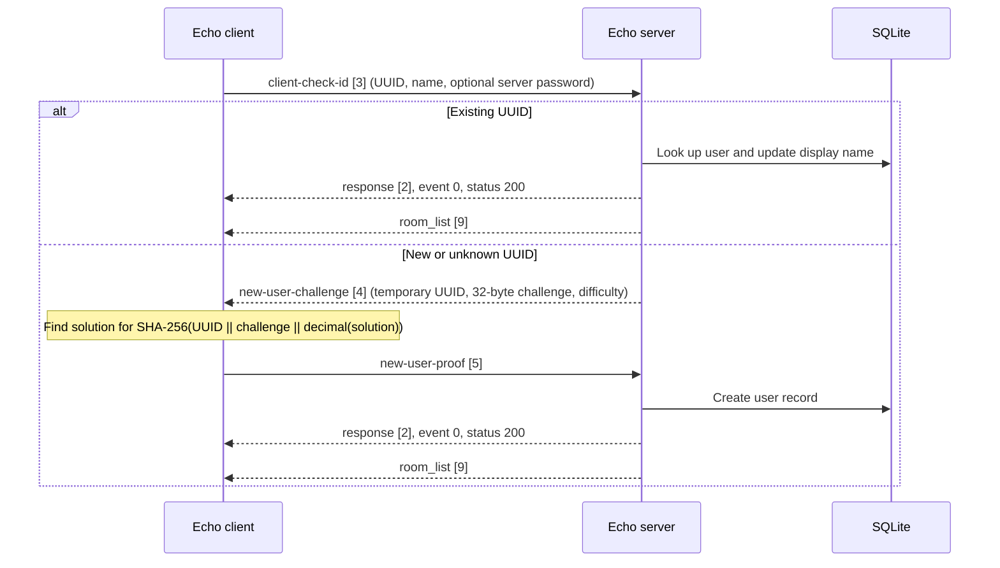
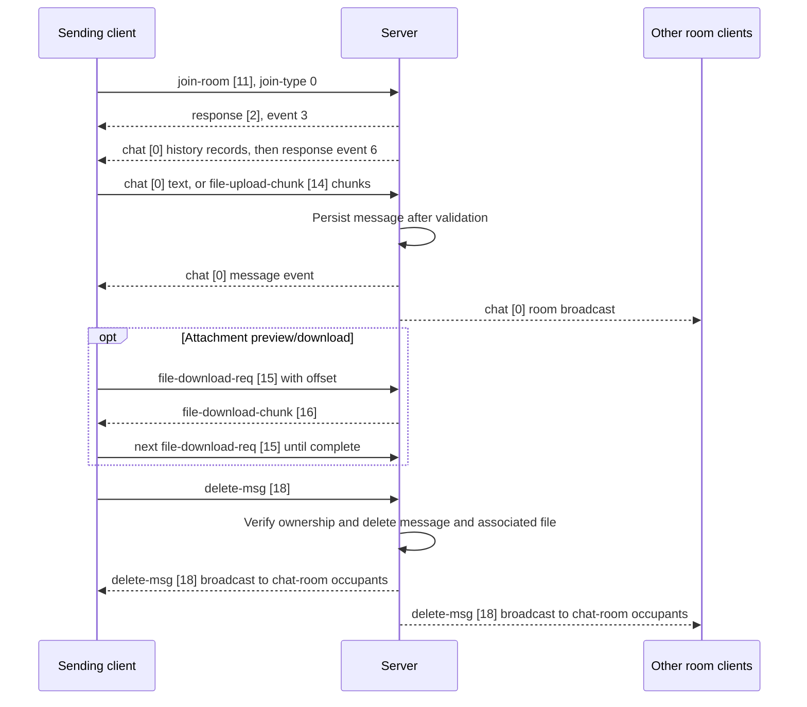

# Echo Client API and Protocol Reference

This document describes the client-facing wire protocol and how the Echo client
uses it. The ASN.1 source of truth is [`ChatProtocol.asn`](../ChatProtocol.asn).
The client and server currently use matching copies of that schema. There is no
protocol version negotiation.

## Architecture

The client uses two independent transports:

| Transport | Purpose | Default endpoint |
|---|---|---|
| TCP | Authentication, room state, chat, roles, profiles, and file transfer | Server port `5555` |
| UDP | Opus voice packets and voice state | Same numeric port, separate UDP socket |

TCP messages are ASN.1 DER. Every TCP frame is a two-byte unsigned big-endian
DER byte length followed by exactly that many bytes. Large files are divided
into chunks. The client can initiate TLS, but the bundled server accepts plain
TCP; deployments terminate TLS in a proxy or must provide a TLS-capable
endpoint.

The client processes received TCP events on the application thread after a
network worker reads and frames packets. It dispatches the ASN.1 `CHOICE` tag
to the corresponding client handler, then acknowledges the network worker so
it can continue draining its bounded packet queue.

## Event diagrams

### Connection and registration

### Chat, history, attachments, and deletion

Voice is a separate UDP path. The client first joins voice using `join-room`
with `join-type = 1`, then sends `VOICE_STATE`/`VOICE_PING` and Opus
`VOICE_DATA` packets over UDP. TCP chat membership is unchanged when voice
membership changes.

## TCP request and event catalog

Each `ProtocolMessage` is exactly one ASN.1 `CHOICE` alternative. Field names
below use the hyphenated ASN.1 spellings. `INTEGER` values are written by this
implementation as non-negative values unless stated otherwise.

| Tag | Alternative | Direction | ASN.1 fields |
|---:|---|---|---|
| 0 | `chat` | Client ↔ server | `room-id INTEGER`, `msg-id INTEGER`, `sender-id INTEGER`, `sender UTF8String`, `sender-avatar UTF8String`, `content UTF8String`, `msg-type INTEGER`, `timestamp INTEGER` |
| 1 | `system` | Server → client (schema only) | `cpu-load INTEGER`, `uptime INTEGER` |
| 2 | `response` | Server → client | `event INTEGER`, `status INTEGER`, `message UTF8String OPTIONAL` |
| 3 | `client-check-id` | Client → server | `uuid UTF8String`, `name UTF8String`, `password UTF8String OPTIONAL` |
| 4 | `new-user-challenge` | Server → client | `uuid UTF8String`, `challenge OCTET STRING`, `difficulty INTEGER` |
| 5 | `new-user-proof` | Client → server | `uuid UTF8String`, `solution INTEGER` |
| 6 | `claim-admin-privilege` | Client → server | `key UTF8String` |
| 7 | `member_list` | Server → client | `SEQUENCE OF { id INTEGER, name UTF8String, avatar UTF8String, is-online BOOLEAN OPTIONAL, is-admin BOOLEAN OPTIONAL }` |
| 8 | `member_detail` | Server → client | `id INTEGER`, `name UTF8String`, `avatar UTF8String`, `created-at INTEGER`, `last-seen INTEGER`, `status INTEGER`, `roles UTF8String OPTIONAL` |
| 9 | `room_list` | Server → client | `SEQUENCE OF { id INTEGER, name UTF8String, users-in-voice-room SEQUENCE OF { id INTEGER, name UTF8String, avatar UTF8String, is-mute BOOLEAN, is-deaf BOOLEAN } OPTIONAL, has-password BOOLEAN OPTIONAL, needed-voice-join-power INTEGER OPTIONAL, needed-chat-join-power INTEGER OPTIONAL, needed-speak-power INTEGER OPTIONAL }` |
| 10 | `create-room` | Client → server | `name UTF8String`, `password UTF8String`, `limit-clients INTEGER`, `needed-voice-join-power INTEGER`, `needed-chat-join-power INTEGER`, `needed-speak-power INTEGER` |
| 11 | `join-room` | Client → server | `room-id INTEGER`, `password UTF8String OPTIONAL`, `join-type INTEGER OPTIONAL` |
| 12 | `update-server-settings` | Client → server | `server-name UTF8String`, `server-password UTF8String` |
| 13 | `leave-room` | Client → server | `room-id INTEGER`, `leave-type INTEGER OPTIONAL` |
| 14 | `file-upload-chunk` | Client → server | `upload-id UTF8String`, `room-id INTEGER`, `file-name UTF8String`, `total-size INTEGER`, `offset INTEGER`, `msg-type INTEGER`, `data OCTET STRING` |
| 15 | `file-download-req` | Client → server | `room-id INTEGER`, `file-path UTF8String`, `offset INTEGER` |
| 16 | `file-download-chunk` | Server → client | `room-id INTEGER`, `file-path UTF8String`, `total-size INTEGER`, `offset INTEGER`, `data OCTET STRING` |
| 17 | `history-req` | Client → server | `room-id INTEGER`, `before-id INTEGER`, `limit INTEGER` |
| 18 | `delete-msg` | Client → server request; server → room broadcast | `room-id INTEGER`, `msg-id INTEGER` |
| 19 | `get-my-info` | Client → server | `dummy INTEGER OPTIONAL` |
| 20 | `my-info` | Server → client | `id INTEGER`, `uuid UTF8String`, `name UTF8String`, `avatar UTF8String`, `created-at INTEGER`, `server-uptime INTEGER` |
| 21 | `avatar-upload-chunk` | Client → server | `upload-id UTF8String`, `file-name UTF8String`, `total-size INTEGER`, `offset INTEGER`, `data OCTET STRING` |
| 22 | `get-roles-req` | Client → server | `dummy INTEGER OPTIONAL` |
| 23 | `role-list` | Server → client | `SEQUENCE OF { id INTEGER, name UTF8String, permissions UTF8String }` |
| 24 | `create-role` | Client → server | `name UTF8String` |
| 25 | `update-role-perms` | Client → server | `role-id INTEGER`, `permissions UTF8String` |
| 26 | `delete-role` | Client → server | `role-id INTEGER` |
| 27 | `get-user-roles-req` | Client → server | `user-id INTEGER` |
| 28 | `user-roles-list` | Server → client | `user-id INTEGER`, `roles-json UTF8String` |
| 29 | `assign-user-roles` | Client → server | `user-id INTEGER`, `role-ids UTF8String` |
| 30 | `kick-user` | Client → server | `user-id INTEGER`, `room-id INTEGER OPTIONAL` |
| 31 | `update-room` | Client → server | `room-id INTEGER`, `name UTF8String`, `password UTF8String`, `needed-voice-join-power INTEGER`, `needed-chat-join-power INTEGER`, `needed-speak-power INTEGER` |
| 32 | `poke-user` | Client → server | `target-user-id INTEGER`, `message UTF8String OPTIONAL` |
| 33 | `get-members-req` | Client → server | `dummy INTEGER OPTIONAL` |
| 34 | `get-member-detail-req` | Client → server | `user-id INTEGER` |

### Field and value semantics

- **Authentication:** An empty UUID requests registration. The server returns a generated UUID in `new-user-challenge`; the client must persist and return it in `new-user-proof`. The challenge contains 32 random bytes, has a 30-second expiry, and currently requires 16 leading zero bits in SHA-256. The hash input is UTF-8 UUID bytes, followed by challenge bytes, followed by the decimal ASCII solution.
- **Chat:** The server uses the authenticated socket identity, not the client-supplied `sender-id` or `sender` fields, when storing and broadcasting text. Text messages use `msg-type = 1`; the server assigns message ID and Unix-seconds timestamp. Attachment messages store a server-relative path in `content`.
- **Message types:** `1` text, `2` image, `3` video, `4` other/file.
- **Room types:** `join-type = 0` joins chat; `join-type = 1` joins voice. `leave-type` uses the same values. Omitted values parse as zero in the current implementation.
- **History:** `before-id = 0` asks for the latest page. Otherwise, the server returns messages with IDs lower than `before-id`. The server clamps limits outside `1..50` to `20`, returns records oldest-first within the page, then sends a `response` with event `6` and `message = "<room-id>:<count>"`. Initial chat-room join requests 20 messages.
- **File uploads:** Chat upload chunks are 32 KiB from the client; the maximum file size is 10 MiB. The server creates the chat message and broadcasts it once the final chunk is received. Avatar chunks are also 32 KiB and the maximum avatar is 2 MiB.
- **File downloads:** Requests use a server-relative `file-path` and byte `offset`. Responses contain up to 32 KiB. Request the next offset until `offset + data length == total-size`. Room files require current chat membership; avatar paths use the `files/avt/` prefix.
- **Role JSON:** `update-role-perms.permissions` is a JSON object mapping permission names to integer values, for example `{"u_chat_join_power":25}`. `role-list.permissions` returns that object as compact JSON. `user-roles-list.roles-json` is a JSON array with `{ "id": number, "name": string, "assigned": boolean }` objects. `assign-user-roles.role-ids` is a comma-separated list such as `"2,4"`.
- **Poke:** The incoming notification uses response event `18`, with message encoded as `"<sender-name>:<sender-id>:<message>"`. A colon inside sender/message is not escaped by the current format.
- **Password sentinels:** For `update-server-settings`, empty `server-password` means leave unchanged and `"__CLEAR__"` means clear it. For `update-room`, empty password means leave unchanged and `"__CLEAR__"` clears it.

## Generic responses

The `response` alternative (tag `2`) carries `event`, `status`, and optional
`message`. Status values in the shared types are:

| Value | Name | Meaning |
|---:|---|---|
| 200 | `SUCCESS` | Operation accepted/succeeded |
| 400 | `ERROR` | Defined in shared types; not the common server failure response |
| 401 | `PASSWORD_REQUIRED` | Server or room password required/incorrect |
| 500 | `FAILED` | Operation rejected or failed |

| Event | Name | Typical purpose and message |
|---:|---|---|
| 0 | `RESPONSE_USER_CHECK_ID` | Login/registration result. Success message is colon-delimited identity metadata; see Authentication above. |
| 1 | `RESPONSE_USER_CLAIM_ADMIN_PRIVILEGE` | Initial admin-token result. |
| 2 | `RESPONSE_CREATE_ROOM` | Room creation result. |
| 3 | `RESPONSE_JOIN_ROOM` | Join result; success message is `"<room-id>:<join-type>"`; password rejection starts `"<room-id>:<join-type>:..."`. |
| 4 | `RESPONSE_UPDATE_SERVER_SETTINGS` | Server setting result; success broadcasts the current server name. |
| 5 | `RESPONSE_FILE_UPLOAD` | File upload result; success message is the stored path. |
| 6 | `RESPONSE_HISTORY` | History page terminator; `"<room-id>:<count>"`. |
| 7 | `RESPONSE_DELETE_MSG` | Delete error response. Successful deletion is delivered as `delete-msg` tag 18, not a success response. |
| 8 | `RESPONSE_AVATAR_UPLOAD` | Avatar upload result; success message is the stored path. |
| 9 | `RESPONSE_CREATE_ROLE` | Role creation result; success message is new role ID. |
| 10 | `RESPONSE_UPDATE_ROLE_PERMS` | Role permission update result. |
| 11 | `RESPONSE_DELETE_ROLE` | Role deletion result. |
| 12 | `RESPONSE_ASSIGN_USER_ROLES` | Role assignment result. |
| 13 | `RESPONSE_KICK_USER` | Kick action result. |
| 14 | `RESPONSE_UPDATE_ROOM` | Room update result. |
| 15 | `RESPONSE_KICKED` | Room access revoked; `chat:<room-id>:<reason>` identifies chat, otherwise voice/server handling is used. |
| 16 | `RESPONSE_PERMS_UPDATED` | Permission refresh; message is `"<is-admin>:<can-kick>"`, each `0` or `1`. |
| 17 | `RESPONSE_POKE_USER` | Result of sending a poke. |
| 18 | `RESPONSE_POKED` | Incoming poke notification. |
| 19 | `RESPONSE_CHAT` | Text send rejection, including rate-limit errors. |

Some successful operations (role list, member list, member details, room list,
and file chunks) are returned using their own `ProtocolMessage` alternative
rather than a generic response.

## Client operation details

### Chat lifecycle

1. Send `join-room` for a room with `join-type = 0`.
2. On event `3` success, show the room and accept history `chat` records.
3. Use `history-req` for older pages while remaining in that chat room.
4. Send `chat` for text. The client currently enforces 5 text messages per
   2 seconds and enters a 5-second timeout; the server enforces its own
   per-connection limit as well.
5. Send `leave-room` with `leave-type = 0` when leaving/switching chat rooms.

### Attachment lifecycle

The client sends each file in sequential `file-upload-chunk` messages with a
shared `upload-id`, total size, increasing offsets, and the same room/file/type
metadata. On completion the server emits the new `chat` attachment record and
an upload response. Images are downloaded in memory for previews; other
attachments are cached locally. An image is rendered only if Qt's image
decoder can parse it.

### Common client helper entry points

These are internal C++ helpers, not a separate public network API:

| Client helper | Wire operation |
|---|---|
| `start_connection`, `connect_server` | TCP connect; `client-check-id` |
| `user_claim_admin_privilege` | `claim-admin-privilege` |
| `user_create_room`, `user_join_room`, `user_leave_room`, `user_update_room` | Room operations |
| `user_send_chat_message`, `user_request_history`, `user_delete_message` | Chat/history/delete |
| `user_upload_file`, `user_request_file_download`, `user_upload_avatar` | File operations |
| `user_request_roles`, `user_create_role`, `user_update_role_permissions`, `user_delete_role`, `user_request_user_roles`, `user_assign_roles` | Role operations |
| `user_request_members`, `user_request_member_detail`, `user_poke_member` | Member and poke operations |

## UDP voice protocol

Voice packets are a packed 29-byte C++ header followed by optional Opus bytes.
The current implementation writes and reads this native packed struct directly
without byte-order conversion; interoperable peers must match the implementation
ABI and byte order (the supported Windows builds are little-endian).

| Offset | Size | Field |
|---:|---:|---|
| 0 | 4 | `magic` = `0x4543484F` (`ECHO` constant) |
| 4 | 1 | `packet_type` |
| 5 | 8 | `user_id` |
| 13 | 8 | `room_id` |
| 21 | 4 | `seq` |
| 25 | 1 | `is_mute` |
| 26 | 1 | `is_deaf` |
| 27 | 2 | `payload_size` |

| Type | Value | Behavior |
|---|---:|---|
| `VOICE_PING` | 1 | Peer keep-alive; client sends every 2 seconds |
| `VOICE_DATA` | 2 | Header followed by one Opus-encoded audio payload |
| `VOICE_LEAVE` | 3 | Explicitly remove the peer from voice routing |
| `VOICE_STATE` | 4 | Update mute/deafen state; no audio payload |

Voice uses Opus, 48 kHz mono. Client audio is packetized in 10 ms frames
(480 samples); configured bitrate is clamped to 16–128 kbps (default 40 kbps).
The maximum accepted Opus payload is 1200 bytes. The server forwards data only
to other active peers in the same authorized voice room, excluding deafened
recipients, and drops muted/non-speaking senders.

## Implementation notes and current limitations

- `SystemStatus` is defined in the ASN.1 schema but is not currently emitted or
  handled by the client.
- `create-room.limit-clients` is stored, but the current join handler does not
  enforce a room capacity limit.
- `member_detail.last-seen` currently carries the admin flag (`0`/`1`), and
  `member_detail.status` currently carries online state (`0`/`1`); the
  `last-seen` timestamp is not sent by the current handler.
- Message deletion is hard deletion. The server checks that the message
  belongs to the requesting user, removes any attachment file, deletes the DB
  row, then broadcasts `delete-msg` to connected chat occupants.
- Voice authorization and TCP chat membership are separate server-side states.

